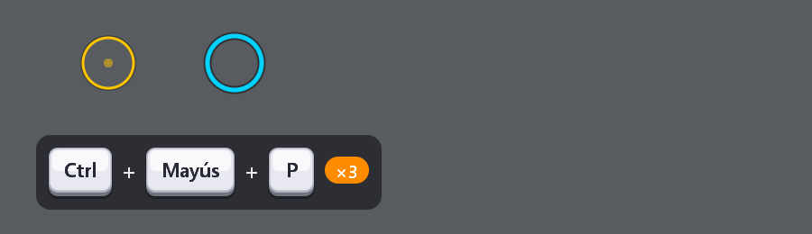

<p align="center"></p>

<h1 align="center">Presenter Toolbox</h1>

<p align="center">
Zoom, dibujo, foco, clics y teclas en pantalla, capturas y grabación GIF<br>
para <b>clases, presentaciones y tutoriales</b> en Windows y Linux.<br>
<sub>By <a href="https://github.com/chalalo1533">@chalalo</a>, basado en el trabajo del gran
<a href="https://learn.microsoft.com/sysinternals/downloads/zoomit">Mark Russinovich</a> (ZoomIt, Sysinternals).</sub>
</p>

<p align="center">
  <a href="../../releases/latest"><b>⬇ Descargar la última versión (Windows .zip · Linux .tar.gz)</b></a>
</p>

---

## Qué hace

| Atajo | Función |
|---|---|
| **Ctrl+1** | **Zoom**: congela la pantalla y la amplía; rueda o ↑/↓ para acercar. Clic para dibujar encima. |
| **Ctrl+2** | **Dibujar** sobre la pantalla: lápiz con suavizado, líneas, flechas, rectángulos, elipses, texto, pizarra blanca/negra. |
| **Ctrl+3** | **Temporizador de descanso** a pantalla completa. |
| **Ctrl+4** | **Zoom en vivo** (la pantalla sigue funcionando, acelerado por la GPU). |
| **Ctrl+5** | **Captura** de la pantalla al portapapeles. |
| **Ctrl+6** / **Ctrl+Mayús+6** | **Recorte** de una zona al portapapeles / a un PNG. |
| **Ctrl+7** | **Foco**: oscurece todo menos un círculo alrededor del mouse. |
| **Ctrl+8** | **Clics y teclas**: ondas de color en cada clic y las combinaciones de teclas dibujadas como teclas reales. |
| **Ctrl+9** | **Grabar GIF** de una zona (otra vez Ctrl+9 para terminar). |
| **Ctrl+0** | **Encontrar el mouse** (opcional: al sacudirlo). |

Todos los atajos se pueden cambiar en **Opciones** (clic en el icono de la bandeja).

<p align="center"></p>

Por privacidad, el modo de teclas muestra por defecto **sólo combinaciones** (Ctrl, Alt, Win) y teclas especiales: lo que escribes, como contraseñas, no aparece.

## Instalación

1. Descarga el `.zip` desde [Releases](../../releases/latest) y descomprímelo donde quieras (también sirve un pendrive).
2. Abre `presenter_toolbox.exe`. No requiere instalación ni dependencias.
3. La primera vez Windows puede mostrar **"Windows protegió su PC"** porque el programa aún no está firmado: *Más información → Ejecutar de todas formas*.

**Modo portable:** mientras exista `portable.ini` junto al `.exe`, la configuración se guarda en esa carpeta; si no, en `%APPDATA%\ZoomItRs`.

Requiere Windows 10 u 11 de 64 bits.

### Linux (X11)

1. Descarga el `.tar.gz` desde [Releases](../../releases/latest) y descomprímelo: `tar -xzf PresenterToolbox-*-linux-x11-x86_64.tar.gz`
2. Ábrelo con `./presenter_toolbox`, o instálalo en tu usuario (menú de aplicaciones, sin sudo) con `./install.sh`.

Funciona en sesiones **X11** (Linux Mint, Xubuntu, MATE, KDE en X11…); compruébalo con `echo $XDG_SESSION_TYPE`. En **Wayland** los atajos globales, la captura y los efectos todavía no funcionan. El foco y los bordes suaves necesitan los efectos de escritorio (compositor) activados. El *zoom en vivo* (Ctrl+4) existe sólo en Windows. La configuración se guarda en `~/.config/presenter-toolbox`.

## Compilar desde el código

Necesitas [Rust](https://rustup.rs) y, en Windows, las *Build Tools* de Visual Studio (C++). En Linux no hace falta nada más.

```powershell
git clone https://github.com/chalalo1533/presenter-toolbox
cd presenter-toolbox
cargo build --release
.\target\release\presenter_toolbox.exe
```

Cada tag `v*` (por ejemplo `v0.2.0`) compila y publica automáticamente el `.zip` de Windows y el `.tar.gz` de Linux en *Releases* mediante GitHub Actions.

Hecho en Rust con [egui/eframe](https://github.com/emilk/egui), la API de Windows y X11 ([x11rb](https://github.com/psychon/x11rb)).

## Créditos

Idea original: **ZoomIt** de Mark Russinovich (Microsoft Sysinternals). Presenter Toolbox es una reimplementación independiente desde cero; no contiene código de ZoomIt.
